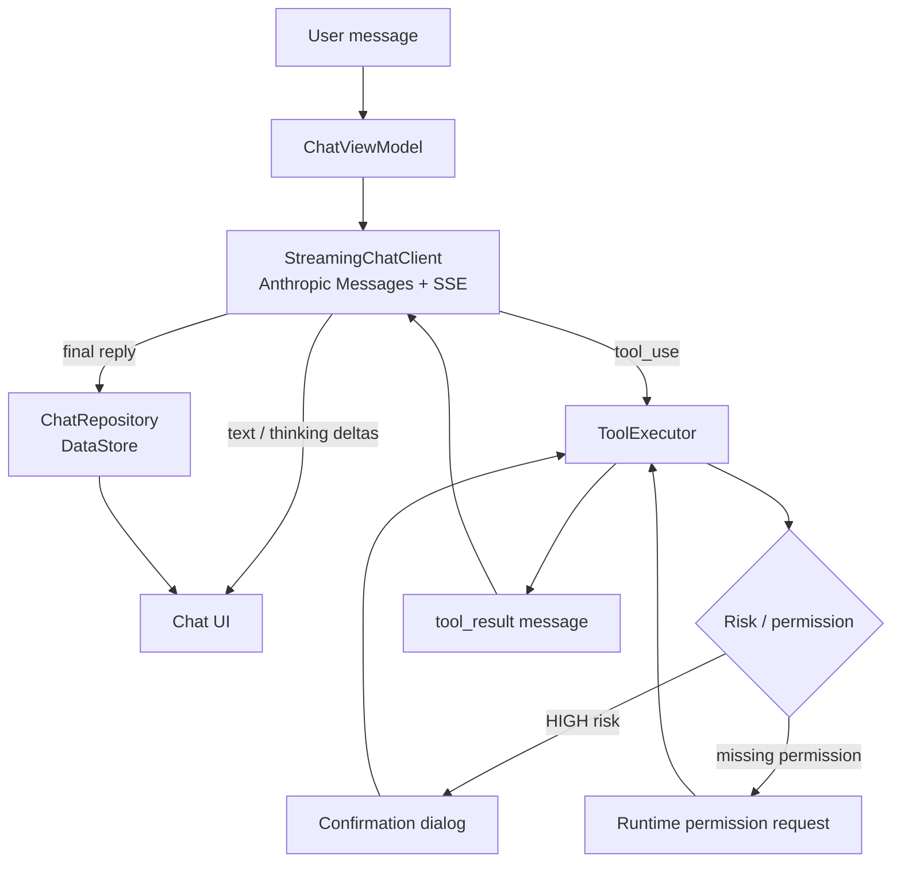

# DoDroidAI

DoDroidAI is an on-device Android agent. Talk to it in natural language and it operates your phone
through LLM tool calling: alarms, calendar events, SMS, notes (placeholder) and web search. Voice
speech input runs fully offline on top of `sherpa-onnx` + SenseVoice.

> 中文说明见 [README_zh.md](README_zh.md)。

---

## Flutter version (migration in progress)

`flutter_app/` contains the Flutter port. It currently covers every native feature except the
WebView SDK, using pure-Flutter implementations wherever possible:

- chat / SSE streaming / tool calling loop / sessions (sqflite)
- offline speech: `sherpa_onnx` Dart FFI for both TTS (MeloTTS) and ASR (SenseVoice), recording via `record`
- tools: battery (`battery_plus`), alarm (`android_intent_plus`), SMS (`url_launcher`), time
- attachments: images (picker + multimodal + persistence) and text files
- notes / memory / scheduled tasks (workmanager reminder) / tool audit / permission policy
- home screen widgets (1x2, 1x4, 2x2 via `home_widget`) and app shortcuts (`quick_actions`)
- Chinese/English i18n, light/dark theme

```bash
cd flutter_app
flutter pub get
flutter build apk --debug
```

See [docs/FLUTTER_MIGRATION.md](docs/FLUTTER_MIGRATION.md) for the migration plan and status table.
The native `app/` is kept as the reference baseline until the Flutter version is released.

---

## Features

- **Multiple AI configurations** — create, clone, activate and delete provider profiles (OpenAI,
  DeepSeek, MiniMax or a custom endpoint). Supports both Anthropic Messages and OpenAI Chat
  Completions-compatible endpoints.
- **Streaming responses** — Server-Sent Events; text and extended-thinking deltas are rendered as they
  arrive, with a collapsible thinking block.
- **Tool calling with guardrails** — the model can call six phone tools. High-risk tools require an
  in-app confirmation, and missing runtime permissions are requested before execution.
- **Offline speech-to-text** — `sherpa-onnx` + SenseVoice; the model (~226 MB) is downloaded once in Settings, then works fully offline.
- **Text-to-speech** — read assistant replies aloud with the system TTS engine.
- **Web search** — a `web_search` tool backed by the Brave Search API (10-minute in-memory cache).
- **Markdown rendering** — assistant messages are rendered with Markwon.
- **Chat history** — sessions and messages are persisted locally with DataStore.
- **Attachments** — pick images, PDF or text files from camera/gallery/file picker. Images are sent as
  multimodal content; PDF/TXT text is extracted and sent as context. Word files are rejected for now.
- **Home-screen widgets** — 1×2, 1×4 and 2×2 widgets that jump straight into a new conversation.
- **"Look" shortcut** — opens the built-in `webview-sdk` demo page with a JS bridge that drives the
  native toolbar (title, colors, gradient, scroll-linked alpha).
- **Theme and language** — light / dark / system theme; English, Simplified Chinese and Traditional
  Chinese.

---

## Requirements

- Android 7.0 (API 24) or newer on an **ARM device** (`arm64-v8a` or `armeabi-v7a`). No x86_64 ABI is
  packaged, so most x86 emulators cannot install the APK directly.
- Network access for the AI endpoint and web search.
- For building: JDK 17, Android SDK 36. Gradle is
  provided by the wrapper.

---

## Build

```bash
git clone https://github.com/lvtong199881/DoDroidAI.git
cd DoDroidAI

# Optional: point Gradle at your SDK (Android Studio generates this automatically)
# local.properties: sdk.dir=/path/to/Android/sdk

./gradlew assembleDebug
```

The APK is written to `app/build/outputs/apk/debug/app-debug.apk`.

Other useful commands:

| Command | Purpose |
| --- | --- |
| `./gradlew :app:assembleDebug` | Build the app module only |
| `./gradlew :webview-sdk:assembleDebug` | Build the standalone WebView library |
| `./gradlew assembleRelease` | Build a release APK (uses the bundled test keystore) |
| `./gradlew lintDebug` | Run Android Lint |
| `./gradlew clean` | Clean build outputs |

Notes:

- The Gradle wrapper downloads its distribution from a Tencent Cloud mirror. If that mirror is not
  reachable, edit `gradle/wrapper/gradle-wrapper.properties`.
- Native speech libraries are prebuilt (`jniLibs`), so no NDK/CMake step is required.
- `local.properties` is machine-specific and must not be committed.

## Install

```bash
adb install -r app/build/outputs/apk/debug/app-debug.apk
```

Or open the project in Android Studio and run the `app` configuration on a connected device.

---

## Configuration

1. Open **Settings → AI Configuration** and add a configuration (the `+` action). Pick a preset or
   `Custom`.
2. Fill in:
   - **API Format** — `Anthropic Messages` or `OpenAI Chat Completions`.
   - **Base URL** — the root URL only. The app appends `/v1/messages` (Anthropic) or
     `/v1/chat/completions` (OpenAI), so do **not** include `/v1` or the full path.
   - **API Key** — sent as `X-Api-Key` for Anthropic, or `Authorization: Bearer` for OpenAI.
   - **Model** — the model name understood by that endpoint.
3. Save the configuration and mark it active.
4. Optional: configure **Settings → Web Search** with a
   [Brave Search API](https://brave.com/search/api/) key to enable the `web_search` tool.
5. Go back to the chat and try something like *"Set an alarm for 7:30 tomorrow"* or *"What's the
   weather in Shanghai?"*. High-risk actions such as sending an SMS will ask for confirmation first.

Preset examples (these are templates — any compatible gateway works):

| Preset | Base URL | Default model |
| --- | --- | --- |
| DeepSeek | `https://api.deepseek.com/anthropic` | `DeepSeek-V4-Flash` — Anthropic Messages format |
| MiniMax | `https://api.minimaxi.com/anthropic` | `MiniMax-M2.7` — Anthropic Messages format |
| OpenAI | `https://api.openai.com` | `gpt-4o` — OpenAI Chat Completions format |
| Custom | — | — |

HTTPS is required: cleartext HTTP is blocked by the app's target SDK and no cleartext exception is
configured.

---

## How it works



- `ChatViewModel` sends the last 20 messages plus the enabled tool schemas to the endpoint and keeps a
  tool loop running for up to 5 rounds.
- Tool calls are executed on-device. Results are fed back as `tool_result` content blocks so the model
  can produce the final answer.
- Sessions are serialized as JSON into Preferences DataStore; there is no Room database.

## Project layout

```
DoDroidAI/
├── app/                                  Android application module
│   └── src/main/
│       ├── java/com/example/dodroidai/
│       │   ├── MainActivity.kt           Entry point, drawer, theme/locale injection
│       │   ├── DoDroidAIApplication.kt   App-scoped repository and tool executor
│       │   ├── ai/
│       │   │   ├── config/               AIConfig, multi-config persistence
│       │   │   ├── model/                Request/response models, SSE request factory
│       │   │   ├── streaming/            SSE client and Anthropic event listener
│       │   │   ├── tools/                Tool abstraction, 6 tools, executor, schemas
│       │   │   └── voice/                sherpa-onnx engine, recorder, TTS
│       │   ├── data/                     ChatSession model and DataStore repository
│       │   ├── ui/                       chat, settings, common widgets
│       │   ├── alarm/                    AlarmReceiver
│       │   └── widget/                   Home-screen widgets (1x2, 1x4, 2x2)
│       ├── jni/                          prebuilt sherpa-onnx libraries
│       └── res/                          Layouts, drawables, strings (en / zh-rCN / zh-rTW), themes
├── webview-sdk/                          Standalone WebView library (Fragment + toolbar + JS bridge)
├── gradle/libs.versions.toml             Version catalog for the app module
├── docs/ROADMAP.md                       Forward-looking roadmap and priorities
├── plan/                                 Design notes and historical plans
└── .github/workflows/                    Manual release build
```

Candidate directions, priorities and open questions are tracked in
[docs/ROADMAP.md](docs/ROADMAP.md).

## Built-in tools

| Tool | Risk | Runtime permission | Behavior |
| --- | --- | --- | --- |
| `get_current_time` | Low | — | Returns the device date and time |
| `set_alarm` | Medium | — | Fires `AlarmClock.ACTION_SET_ALARM` (system UI skipped) |
| `add_calendar_event` | Medium | `READ_CALENDAR`, `WRITE_CALENDAR` | Inserts an event through `CalendarContract` |
| `send_sms` | High | `SEND_SMS` | Sends an SMS after in-app confirmation |
| `add_note` | High | — | Placeholder implementation; returns a success string without persisting anything |
| `web_search` | Low | — | Brave Search API, 10-minute cache |

Risk levels are defined in `ToolDefinition`; `HIGH` triggers the confirmation dialog, `MEDIUM` and
`LOW` execute directly.

## Tech stack

| Layer | Technology |
| --- | --- |
| Language | Kotlin 2.0.21, sherpa-onnx (prebuilt JNI) |
| UI | XML Views, Material 3, Markwon (Markdown), fragments |
| Architecture | Single Activity + MVVM (ViewModel + Repository), no DI framework |
| Networking | OkHttp + `okhttp-sse` (Retrofit is on the classpath but the chat request is built with OkHttp directly) |
| Attachments | PDFBox-Android (PDF text extraction), Coil (thumbnails), Android `Bitmap`/EXIF processing |
| Storage | DataStore Preferences + Gson |
| Speech | sherpa-onnx + SenseVoice (offline), Android `TextToSpeech` |
| Build | Gradle 9.1.0, AGP 9.0.1, JDK 17, `compileSdk` 36, `minSdk` 24 |

## Permissions

| Permission | Used for |
| --- | --- |
| `INTERNET` | AI API calls and web search |
| `CAMERA` | In-app photo capture |
| `RECORD_AUDIO` | Voice input |
| `SEND_SMS` | `send_sms` tool |
| `READ_CALENDAR`, `WRITE_CALENDAR` | `add_calendar_event` tool |
| `SET_ALARM` | `set_alarm` tool |
| `RECEIVE_BOOT_COMPLETED` | Declared in the manifest; not used by the current code |

## Security notes

- API keys and other settings are stored in the app-private DataStore (plain preferences, protected
  only by the OS sandbox). They are not hardware-encrypted.
- Attachments (images, PDF/TXT text) are sent to the AI endpoint you configure. Avoid attaching
  sensitive files.
- Tool calls perform real system actions. SMS and note operations require confirmation; review the
  code before trusting a new endpoint.
- The repository ships a **test-only** release keystore (`keystore/release.keystore`). Replace the
  signing configuration before publishing a production build.

## Known limitations

- Scanned PDFs are not OCR'd; only PDFs with an extractable text layer are sent.
- Word files are not supported yet; convert them to PDF or TXT.
- `add_note` does not persist anything yet.
- Only Anthropic Messages and OpenAI Chat Completions formats are supported; the OpenAI Responses
  API is not implemented.
- No unit/UI tests are included, and CI only builds releases on manual dispatch.
- Traditional Chinese (`values-zh-rTW`) has fewer translated strings than English/Simplified Chinese;
  missing entries fall back to English.
- There is no "stop generation" control in the chat UI.
- Release builds are not minified (`isMinifyEnabled = false`), and no ProGuard rules file is checked
  in yet.

## Release automation

`.github/workflows/appbuildfjhfjh.yml` is triggered manually (`workflow_dispatch`). It sets up JDK 17
and the Android SDK, runs `./gradlew assembleRelease`, renames the APK and publishes it to a GitHub
Release tagged `release-<run_number>`.

## Acknowledgements

- [whisper.cpp](https://github.com/ggml-org/whisper.cpp) and [ggml](https://github.com/ggml-org/ggml)
  for on-device speech recognition.
- [Brave Search API](https://brave.com/search/api/) for web search.
- [Markwon](https://github.com/noties/Markwon) for Markdown rendering.
- [OkHttp](https://square.github.io/okhttp/) for networking.

No license file is currently included in this repository; contact the author before redistributing.
