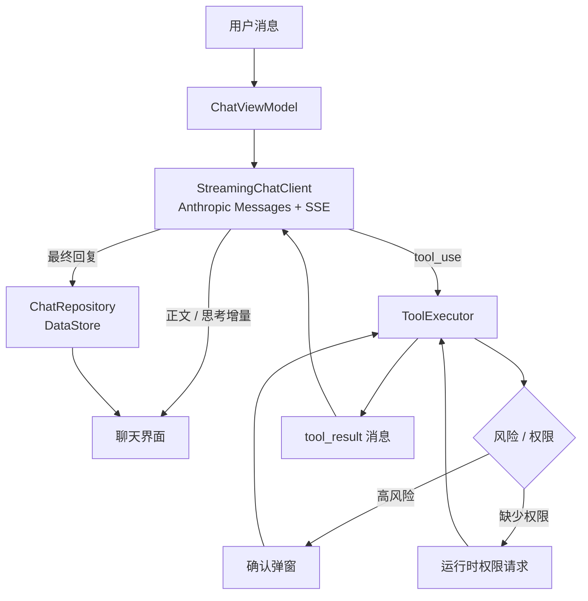

# DoDroidAI

DoDroidAI 是一个运行在手机本地的 Android Agent 应用。用自然语言和它对话，它会通过 LLM 的
tool calling 真正操作手机：闹钟、日历、短信、笔记（占位实现）和联网搜索。
语音输入基于 `sherpa-onnx` + SenseVoice，完全离线。

> English documentation: [README.md](README.md)

---

## Flutter 版本（迁移中）

`flutter_app/` 是迁移到 Flutter 的版本，除 WebView SDK 外已覆盖原生全部功能，并尽量使用纯 Flutter 实现：

- 聊天 / SSE 流式 / 工具调用循环 / 会话（sqflite）
- 离线语音：`sherpa_onnx` Dart FFI（TTS MeloTTS + ASR SenseVoice），录音用 `record`
- 工具：电池（`battery_plus`）、闹钟（`android_intent_plus`）、短信（`url_launcher`）、时间
- 附件：图片（选图 + 多模态 + 持久化）、文本文件
- 笔记 / 记忆 / 定时任务（workmanager 提醒）/ 工具审计 / 权限策略
- 桌面小组件（1x2、1x4、2x2，`home_widget`）与快捷方式（`quick_actions`）
- 中英文 i18n、浅色/深色主题

```bash
cd flutter_app
flutter pub get
flutter build apk --debug
```

迁移计划与完成度见 [docs/FLUTTER_MIGRATION.md](docs/FLUTTER_MIGRATION.md)。
原生 `app/` 在 Flutter 版发布前保留作为参照基线。

---

## 功能

- **多套 AI 配置**：新增、克隆、启用、删除 AI 配置（OpenAI、DeepSeek、MiniMax 或自定义端点）。
  支持 Anthropic Messages 与 OpenAI Chat Completions 两种兼容格式。
- **流式输出**：基于 SSE，正文和扩展思考过程边生成边展示，思考内容可折叠查看。
- **带防护的工具调用**：模型可调用 6 个手机工具。高风险工具执行前会弹应用内确认框；
  缺少运行时权限时先请求权限再执行。
- **离线语音识别**：`sherpa-onnx` + SenseVoice，模型（约 226 MB）在设置中下载一次后可完全离线使用。
- **TTS 语音播报**：用系统 TTS 朗读 AI 回复。
- **联网搜索**：`web_search` 工具接入 Brave Search API，内存缓存 10 分钟。
- **Markdown 渲染**：AI 回复通过 Markwon 渲染。
- **会话历史**：会话与消息通过 DataStore 持久化在本地。
- **附件**：支持拍照、相册、文件（图片、PDF、TXT）。图片作为多模态内容发送；
  PDF/TXT 抽取文本后作为上下文；Word 暂不支持。
- **桌面小组件**：1×2、1×4、2×2 三种尺寸，点击直接进入新对话。
- **「去看看」快捷方式**：打开内置的 `webview-sdk` 示例页；H5 可通过 JS Bridge 控制原生
  Toolbar（标题、文字色、渐变背景、滚动联动透明度）。
- **主题与多语言**：浅色 / 深色 / 跟随系统；英文、简体中文、繁体中文。

---

## 环境要求

- Android 7.0（API 24）及以上的 **ARM 设备**（`arm64-v8a` 或 `armeabi-v7a`）。
  没有打包 x86_64 ABI，多数 x86 模拟器无法直接安装。
- 能访问 AI 接口与联网搜索服务的网络。
- 构建需要：JDK 17、Android SDK 36。Gradle 由 wrapper 提供。

---

## 构建

```bash
git clone https://github.com/lvtong199881/DoDroidAI.git
cd DoDroidAI

# 可选：让 Gradle 找到你的 SDK（用 Android Studio 打开会自动生成）
# local.properties: sdk.dir=/path/to/Android/sdk

./gradlew assembleDebug
```

产物位于 `app/build/outputs/apk/debug/app-debug.apk`。

其他常用命令：

| 命令 | 用途 |
| --- | --- |
| `./gradlew :app:assembleDebug` | 只构建 app 模块 |
| `./gradlew :webview-sdk:assembleDebug` | 只构建 WebView 组件库 |
| `./gradlew assembleRelease` | 构建 release APK（使用仓库内置测试签名） |
| `./gradlew lintDebug` | 运行 Android Lint |
| `./gradlew clean` | 清理构建产物 |

说明：

- Gradle wrapper 的发行版从腾讯云镜像下载；如果网络不通，请修改
  `gradle/wrapper/gradle-wrapper.properties`。
- 语音原生库使用预编译 `.so`（`jniLibs`），无需 NDK/CMake 构建。
- `local.properties` 是本机配置，不要提交到仓库。

## 安装

```bash
adb install -r app/build/outputs/apk/debug/app-debug.apk
```

也可以直接用 Android Studio 打开项目，在已连接的设备上运行 `app` 配置。

---

## 配置

1. 打开 **设置 → AI 配置**，点击 `+` 新增配置，选择一个预设或 `自定义`。
2. 填写：
   - **API 格式**：`Anthropic Messages` 或 `OpenAI Chat Completions`。
   - **接口地址（Base URL）**：只填根地址。应用会按格式拼接 `/v1/messages` 或
     `/v1/chat/completions`，所以**不要**包含 `/v1` 或完整路径。
   - **API Key**：Anthropic 格式通过 `X-Api-Key` 发送，OpenAI 格式通过
     `Authorization: Bearer` 发送。
   - **模型**：该接口支持的模型名。
3. 保存后把这条配置设为启用。
4. 可选：在 **设置 → 联网搜索** 填入
   [Brave Search API](https://brave.com/search/api/) 的 Key，启用 `web_search` 工具。
5. 回到聊天页，试着说 *“明天早上 7:30 设个闹钟”* 或 *“上海天气怎么样”*。
   发短信这类高风险操作会先弹确认框。

预设示例（只是模板，任何兼容网关都可以）：

| 预设 | 接口地址 | 默认模型 |
| --- | --- | --- |
| DeepSeek | `https://api.deepseek.com/anthropic` | `DeepSeek-V4-Flash`——Anthropic Messages 格式 |
| MiniMax | `https://api.minimaxi.com/anthropic` | `MiniMax-M2.7`——Anthropic Messages 格式 |
| OpenAI | `https://api.openai.com` | `gpt-4o`——OpenAI Chat Completions 格式 |
| 自定义 | — | — |

接口必须使用 HTTPS：应用的 targetSdk 默认禁止明文 HTTP，也没有配置明文例外。

---

## 工作原理



- `ChatViewModel` 把最近 20 条消息和启用的工具 Schema 发给接口，并维持最多 5 轮的工具循环。
- 工具在设备本地执行，结果以 `tool_result` 内容块回传给模型，由模型生成最终回复。
- 会话以 JSON 形式写入 Preferences DataStore，没有使用 Room。

## 项目结构

```
DoDroidAI/
├── app/                                  Android 应用模块
│   └── src/main/
│       ├── java/com/example/dodroidai/
│       │   ├── MainActivity.kt           入口、侧边栏、主题/语言注入
│       │   ├── DoDroidAIApplication.kt   全局仓库与工具执行器
│       │   ├── ai/
│       │   │   ├── config/               AIConfig、多配置持久化
│       │   │   ├── model/                请求/响应模型、SSE 请求构造
│       │   │   ├── streaming/            SSE 客户端与 Anthropic 事件解析
│       │   │   ├── tools/                工具抽象、6 个工具、执行器、Schema
│       │   │   └── voice/                sherpa-onnx 引擎、录音、TTS
│       │   ├── data/                     会话模型与 DataStore 仓库
│       │   ├── ui/                       聊天、设置、通用控件
│       │   ├── alarm/                    AlarmReceiver
│       │   └── widget/                   桌面小组件（1x2 / 1x4 / 2x2）
│       ├── jni/                          预编译 sherpa-onnx 库
│       └── res/                          布局、图标、三语字符串、主题
├── webview-sdk/                          独立 WebView 组件库（Fragment + Toolbar + JS Bridge）
├── gradle/libs.versions.toml             app 模块的版本目录
├── docs/ROADMAP.md                       迭代路线图
├── plan/                                 设计文档与历史方案
└── .github/workflows/                    手动触发的发布构建
```

候选方向、优先级与待决策问题见 [docs/ROADMAP.md](docs/ROADMAP.md)。

## 内置工具

| 工具 | 风险等级 | 运行时权限 | 行为 |
| --- | --- | --- | --- |
| `get_current_time` | 低 | — | 返回设备当前日期时间 |
| `set_alarm` | 中 | — | 发送 `AlarmClock.ACTION_SET_ALARM`（跳过系统界面） |
| `add_calendar_event` | 中 | `READ_CALENDAR`、`WRITE_CALENDAR` | 通过 `CalendarContract` 插入事件 |
| `send_sms` | 高 | `SEND_SMS` | 应用内确认后发送短信 |
| `add_note` | 高 | — | 占位实现，只返回成功文案，不落库 |
| `web_search` | 低 | — | Brave Search API，缓存 10 分钟 |

风险等级定义在 `ToolDefinition` 中：`高` 会触发确认弹窗，`中` / `低` 直接执行。

## 技术栈

| 层次 | 技术 |
| --- | --- |
| 语言 | Kotlin 2.0.21、sherpa-onnx（预编译 JNI） |
| UI | XML Views、Material 3、Markwon（Markdown）、Fragment |
| 架构 | 单 Activity + MVVM（ViewModel + Repository），无 DI 框架 |
| 网络 | OkHttp + `okhttp-sse`（依赖里有 Retrofit，但聊天请求由 OkHttp 直接构造） |
| 附件 | PDFBox-Android（PDF 文本抽取）、Coil（缩略图）、Android Bitmap/EXIF 处理 |
| 存储 | DataStore Preferences + Gson |
| 语音 | sherpa-onnx + SenseVoice（离线）、Android `TextToSpeech` |
| 构建 | Gradle 9.1.0、AGP 9.0.1、JDK 17、`compileSdk` 36、`minSdk` 24 |

## 权限

| 权限 | 用途 |
| --- | --- |
| `INTERNET` | 调用 AI 接口、联网搜索 |
| `CAMERA` | 应用内拍照 |
| `RECORD_AUDIO` | 语音输入 |
| `SEND_SMS` | `send_sms` 工具 |
| `READ_CALENDAR`、`WRITE_CALENDAR` | `add_calendar_event` 工具 |
| `SET_ALARM` | `set_alarm` 工具 |
| `RECEIVE_BOOT_COMPLETED` | 已在清单声明，当前代码未使用 |

## 安全说明

- API Key 等配置保存在应用私有 DataStore 中（普通偏好存储，仅由系统沙箱保护），并非硬件级加密。
- 附件（图片、PDF/TXT 文本）会发送给你配置的 AI 服务商，请避免附加敏感文件。
- 工具调用会执行真实的系统操作。短信、笔记类操作需要用户确认；接入新的 AI 网关前请先审查代码。
- 仓库内的 release 签名文件（`keystore/release.keystore`）**仅供测试**。正式发布前请替换为
  自己的签名配置。

## 已知限制

- 扫描版 PDF 不做 OCR，只发送能抽取到文本层的 PDF。
- 暂不支持 Word，请先转为 PDF 或 TXT。
- `add_note` 尚未真正持久化任何内容。
- 只支持 Anthropic Messages 与 OpenAI Chat Completions 两种格式；暂不支持 OpenAI Responses API。
- 没有单元测试 / UI 测试，CI 只在手动触发时构建 release。
- 繁体中文（`values-zh-rTW`）的翻译条目少于英文和简体中文，缺失项会回退英文。
- 聊天界面没有“停止生成”按钮。
- Release 构建没有开启混淆（`isMinifyEnabled = false`），仓库中也还没有 ProGuard 规则文件。

## 发布流水线

`.github/workflows/appbuildfjhfjh.yml` 需要手动触发（`workflow_dispatch`）。它会准备 JDK 17 与
Android SDK，执行 `./gradlew assembleRelease`，重命名 APK 并发布到 GitHub Release，
tag 为 `release-<run_number>`。

## 致谢

- [whisper.cpp](https://github.com/ggml-org/whisper.cpp) 与
  [ggml](https://github.com/ggml-org/ggml)：端侧语音识别。
- [Brave Search API](https://brave.com/search/api/)：联网搜索。
- [Markwon](https://github.com/noties/Markwon)：Markdown 渲染。
- [OkHttp](https://square.github.io/okhttp/)：网络请求。

本仓库目前没有 LICENSE 文件，如需再分发请联系作者。
